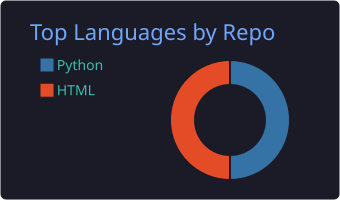
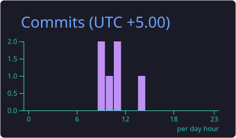

<!-- Шапка -->

  

  

  

<!-- Стек -->
<h3 align="center">🛠 Стек</h3>

  

<!-- Статистика (генерируется GitHub Actions) -->
<h3 align="center">📊 Статистика</h3>

  

  
  

  
  

<!-- Стрик -->

  

<!-- Змейка (генерируется GitHub Actions) -->

  <picture>
    <source media="(prefers-color-scheme: dark)" srcset="https://raw.githubusercontent.com/FishkaDori909/FishkaDori909/output/github-snake-dark.svg" />
    
  </picture>

<!-- Подвал -->

  

